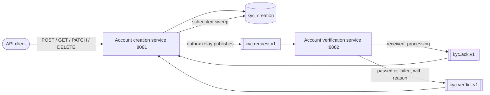
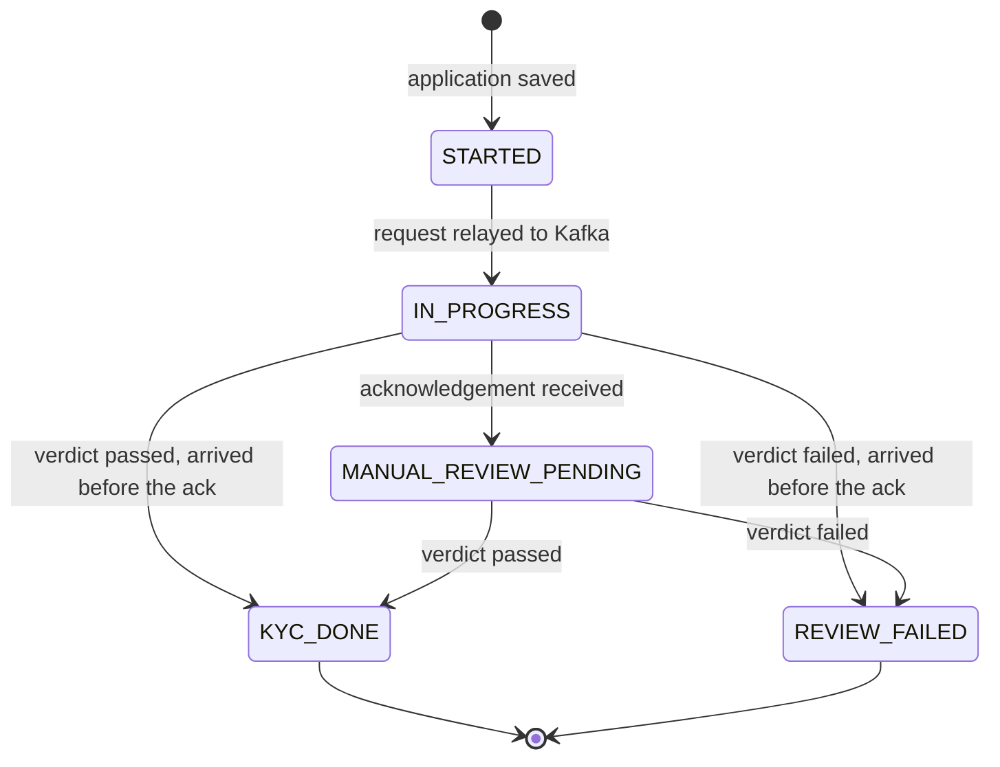
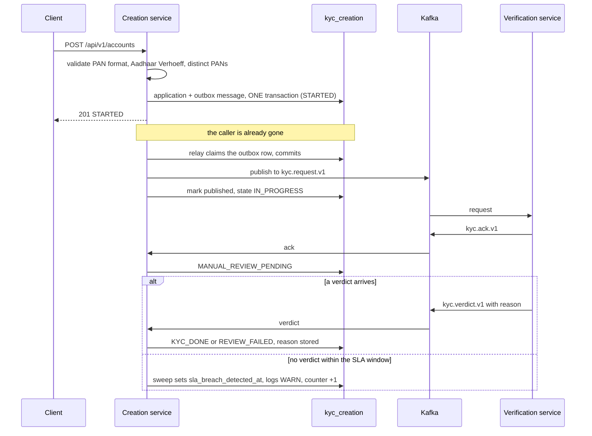
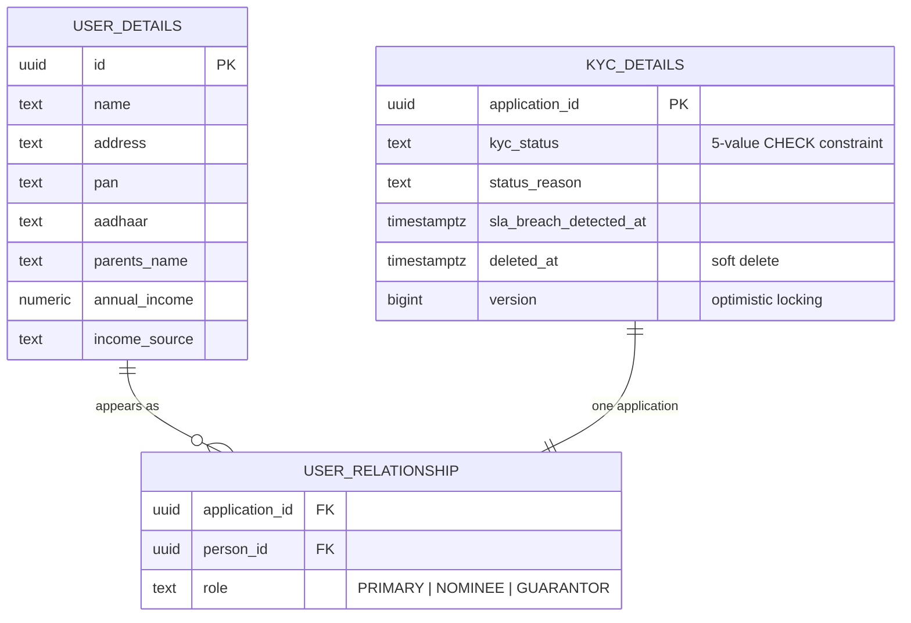

# Account Creation Service

Captures an account application and drives its KYC lifecycle to a terminal decision **without ever
making the caller wait**. Verification is somebody else's job — it happens in
[`account-verification-service`](../account-verification-service/README.md), in another process,
reached only over Kafka.

- **Port:** 8081
- **Database:** `kyc_creation` (PostgreSQL 16, schema owned entirely by Flyway)
- **Swagger UI:** <http://localhost:8081/swagger-ui.html> · **OpenAPI JSON:** `/v3/api-docs`

---

## What problem it solves

Verification of a real KYC application takes hours and sometimes never completes at all. A design
that made the applicant wait for it would be unusable. So this service does three things:

1. **Accepts and persists immediately.** A `POST` returns `201 STARTED` in milliseconds.
2. **Hands off reliably.** The KYC request is written to an outbox *in the same transaction* as the
   application, so a crash can never leave an application that exists but was never submitted.
3. **Refuses to lose anything.** Applications that are never answered are found by a scheduled
   sweep and flagged, rather than sitting at "pending" forever.

---

## Where it sits



This service **publishes** to `kyc.request.v1` and **consumes** `kyc.ack.v1` and `kyc.verdict.v1`.
It never calls the verification service over HTTP, and it has no external HTTP dependency of its own.

---

## The KYC lifecycle

The enum holds exactly the five values from the brief. An SLA breach is deliberately **not** a sixth
state — it is a `sla_breach_detected_at` timestamp recorded alongside whatever state the application
is in, so a late verdict can still be applied afterwards and the breach stays on the record.



Any transition not drawn above is rejected and logged rather than applied. Two deliberate
exceptions: an acknowledgement arriving **after** a final state is ignored without error (an
expected race), and an acknowledgement or verdict arriving while still at `STARTED` is applied as
though `IN_PROGRESS` had already been recorded.

---

## The full request journey



### Why the outbox

Saving the application and publishing to Kafka are two different systems. Doing them as two steps
means a crash in between leaves an application stranded at `STARTED` that nobody will ever verify.

The relay works in three steps and **never holds a database lock across a network call**: it claims
a batch of rows with `FOR UPDATE SKIP LOCKED` in a short transaction and commits; it sends to Kafka
holding no locks; it marks the sends published in a second short transaction. A claim lapses after
a lease, so a crashed relay's rows are picked up again on a later tick.

The cost is that a message can occasionally be sent twice. That is accepted deliberately: every
consumer deduplicates on `(application_id, message_type)` in `processed_message`, within the same
transaction as the state change.

---

## Data model



Plus two infrastructure tables: `outbox` (pending messages, claim/lease columns) and
`processed_message` (consumer deduplication). `flyway_schema_history` is Flyway's own.

One row per person, linked to the application through `user_relationship`, which is what lets the
same person be a nominee on one application and a guarantor on another. A **partial unique index**
(`WHERE deleted_at IS NULL`) enforces one live application per primary applicant PAN — soft-deleting
an application frees the PAN for a new one.

---

## HTTP API

Full interactive documentation is at **<http://localhost:8081/swagger-ui.html>**.

| Method | Path | Notes |
|---|---|---|
| `POST` | `/api/v1/accounts` | Returns `201 STARTED` at once. `409` carries `existingApplicationId`. |
| `GET` | `/api/v1/accounts/{id}` | Current state, reason, and `slaBreachDetectedAt`. |
| `GET` | `/api/v1/accounts` | Paged; filter by `kycStatus` and `slaBreached=true`. |
| `PATCH` | `/api/v1/accounts/{id}` | **Non-identity fields only** — see below. |
| `DELETE` | `/api/v1/accounts/{id}` | Soft delete, `204`. |

### Why update is restricted

Name, PAN and Aadhaar are **immutable**. They are exactly the fields the verification service
checks, and the request is published at creation time — so editing them would mean approving a
record that differs from the one actually verified. Address, annual income, income source and
parents' name stay editable at any time. This narrows the "CRUD" of the brief, deliberately and on
the record.

Deleting an application does **not** tell verification to stop. It runs to completion and any late
message is logged and dropped.

### Error codes

| Code | Status | Meaning |
|---|---|---|
| `VALIDATION_FAILED` | 400 | Malformed PAN, Aadhaar failing the Verhoeff checksum, unknown PATCH property |
| `DUPLICATE_PAN_IN_APPLICATION` | 400 | The three people must have different PANs |
| `IDENTITY_FIELD_IMMUTABLE` | 400 | PATCH tried to change name, PAN or Aadhaar |
| `ACTIVE_APPLICATION_EXISTS` | 409 | Carries `existingApplicationId` so a timed-out client can recover |
| `CONCURRENT_MODIFICATION` | 409 | Optimistic lock clash between two PATCHes |

Errors are RFC 7807 `ProblemDetail`. **A rejected PAN or Aadhaar value is never echoed back**, and
no log line at INFO or above carries a full identifier.

---

## Integration points

### Kafka (the only link to the other service)

| Topic | Direction | Carries |
|---|---|---|
| `kyc.request.v1` | **produces** | name, PAN, Aadhaar for all three people — nothing else |
| `kyc.ack.v1` | **consumes** | "received, review started" |
| `kyc.verdict.v1` | **consumes** | passed/failed plus a human-readable reason |

Every message is keyed by application id, so one application's messages keep their order. Each topic
has retry companions and a `-dlt` dead-letter topic. Income, income source, parents' name and
address are deliberately **not** published: verification has no use for them.

### External HTTP

**None.** This service calls no third party. The PAN/Aadhaar provider is the verification service's
dependency, not this one's.

---

## Configuration

Everything that matters is configuration, not code — which is what makes the 1–2 hour review delay
and the 24 hour SLA testable in seconds.

| Key | Default | Override |
|---|---|---|
| `kyc.sla.window` | `PT24H` | `KYC_SLA_WINDOW` |
| `kyc.sla.sweep-interval` | `PT1M` | `KYC_SLA_SWEEP_INTERVAL` |
| `kyc.outbox.relay-interval` | `PT0.5S` | — |
| `kyc.outbox.claim-lease` | `PT30S` | — |
| `spring.datasource.url` | local compose | `DB_URL`, `DB_USERNAME`, `DB_PASSWORD` |
| `spring.kafka.bootstrap-servers` | `localhost:29092` | `KAFKA_BOOTSTRAP_SERVERS` |

Thread pools are explicitly bounded, never defaulted: `server.tomcat.threads.max=50` and
`spring.task.scheduling.pool.size=3` (relay + SLA sweep, database and Kafka-send work only).

Config lives in `src/main/resources/application.yml`. Spring Boot reads `.yml` and `.properties`
identically; YAML is used here because the `kyc.*` tree is deeply nested.

---

## Build and test

```bash
mvn -B test                      # from the repository root; no Docker daemon needed
```

Tests run PostgreSQL 16 (Zonky, in-process) and Kafka (`spring-kafka-test`, KRaft) inside the JVM.
**90 tests** cover the state machine, validation, the SLA calculation, the outbox relay, idempotent
consumption, and the full round trip with this service's own test double standing in for
verification. Cross-process behaviour is covered separately by [`e2e-tests`](../e2e-tests).
