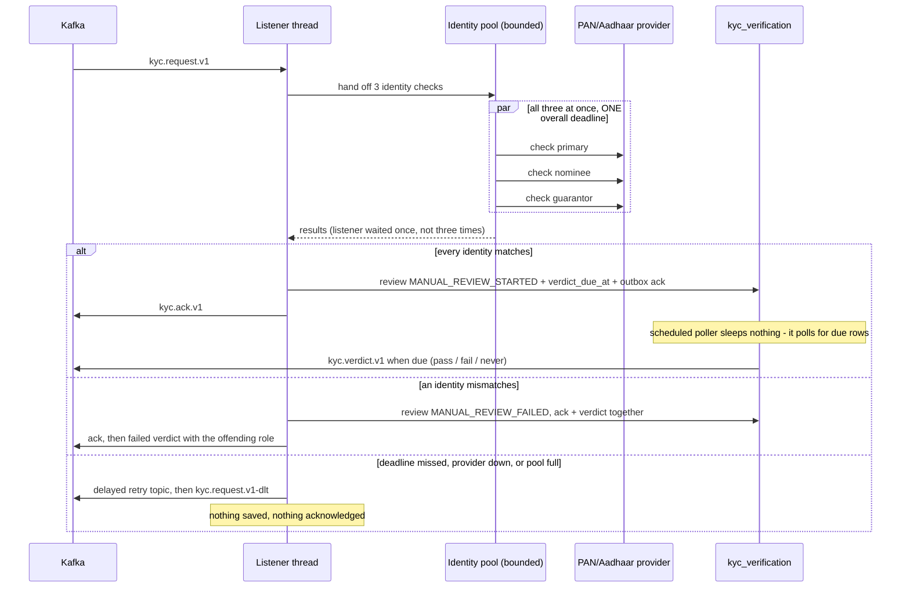
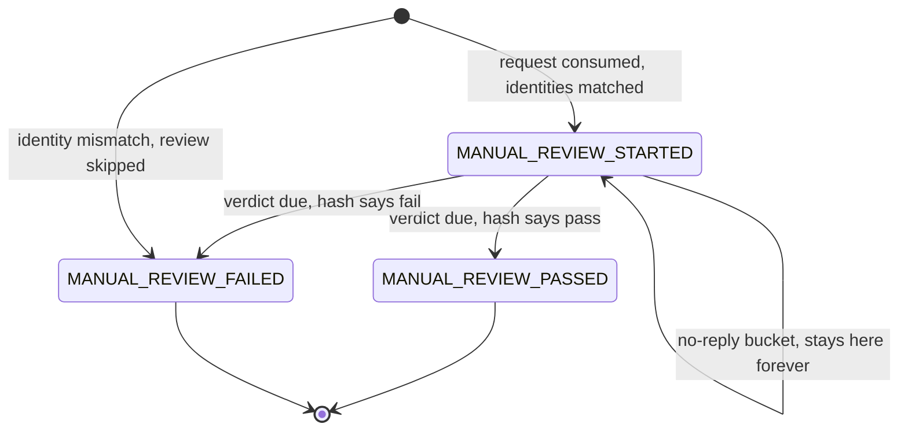
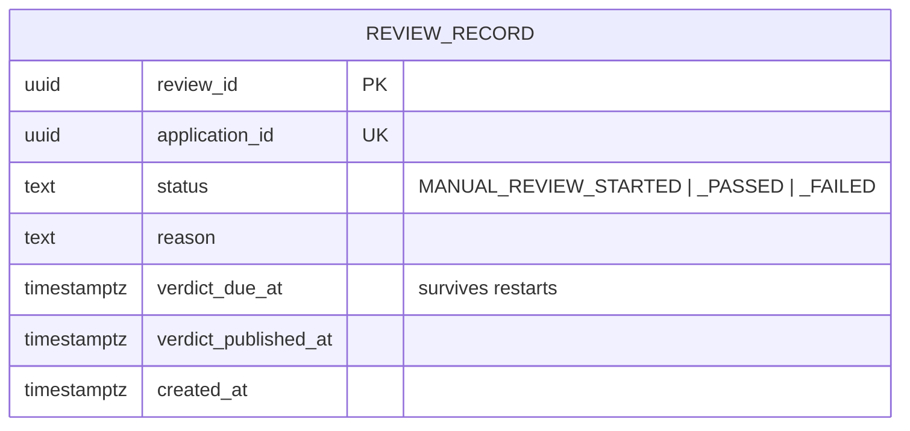

# Account Verification Service

Adjudicates KYC for applications raised by
[`account-creation-service`](../account-creation-service/README.md). It is a **Kafka-driven
service**: its real work arrives on a topic, not on an HTTP request. The single HTTP endpoint exists
so a human can look at what the service decided.

- **Port:** 8082
- **Database:** `kyc_verification` (PostgreSQL 16, Flyway-owned, **shares no tables** with the
  creation service)
- **Swagger UI:** <http://localhost:8082/swagger-ui.html> · **OpenAPI JSON:** `/v3/api-docs`

---

## What it does

In the real world a human agent opens a case, checks documents, and takes hours to decide. Some
cases are never returned at all. This service simulates that faithfully rather than returning an
instant answer:

1. **Checks identity for real** against an external PAN/Aadhaar provider — all three people, in
   parallel, off the Kafka listener thread.
2. **Acknowledges immediately** so the creation service knows the case is live.
3. **Waits out a review period** of 1–2 hours, with the due time stored in the database so the wait
   survives a restart.
4. **Returns a verdict** — roughly 9 passes to every 1 failure, with a reason — except for a fixed
   subset that deliberately **never gets an answer**, which is what exercises the other service's
   SLA handling.

---

## The flow



### Why the identity checks are not on the listener thread

Three sequential HTTP calls on a Kafka listener thread would stall the whole partition for as long
as they take. Instead the listener hands all three to a **separate, explicitly bounded pool** and
waits **once**, for one overall deadline — not three times, once per call. If the deadline passes,
the provider fails, or the pool is full, the attempt counts as "provider unavailable": nothing is
saved or acknowledged, the message goes to a delayed retry topic, and the listener is free for the
next message.

A startup invariant enforces `overall-deadline < read-timeout`. Without it the per-call timeout
always fires first and the deadline path is unreachable — the service would appear to have a
deadline that could never trigger, and the test proving it would pass without exercising anything.

### Why the review delay is stored, not slept

Holding a 1–2 hour delay as an in-memory timer loses every pending review when the service
restarts. Instead each review stores `verdict_due_at`, and a scheduled poller releases whatever has
come due. This survives restarts, occupies no thread while waiting, and compresses to seconds in
tests by changing configuration alone.

---

## Review states



A record sitting at `MANUAL_REVIEW_STARTED` past its due time is one of the deliberate no-reply
cases. Nothing here cleans it up — surfacing it is the creation service's SLA sweep's job.

---

## How an outcome is chosen

**Deterministically, by hashing the application id** — not by a random draw. The same id always
produces the same outcome, so a failure can be reproduced, and tests override the selector bean
rather than retrying until they get lucky.

| Bucket | Share | Result |
|---|---|---|
| No reply | ~5% | No verdict is ever published |
| Pass | ~9 of the remaining 10 | `MANUAL_REVIEW_PASSED`, reason `Manual review passed` |
| Fail | ~1 of the remaining 10 | `MANUAL_REVIEW_FAILED` with a varied reason |

Failure reasons are drawn from a fixed set — *Address proof inconsistent*, *Supporting documents
incomplete*, *Income source unverifiable* — so a consumer sees meaningful text rather than one
canned string.

---

## Integration points

### Kafka

| Topic | Direction | Carries |
|---|---|---|
| `kyc.request.v1` | **consumes** | name, PAN, Aadhaar for all three people |
| `kyc.ack.v1` | **produces** | "received, review started" |
| `kyc.verdict.v1` | **produces** | passed/failed plus the reason |
| `kyc.request.v1-retry-*`, `-dlt` | both | backoff ladder, then the dead letter |

Messages are keyed by application id. Consumption is idempotent on
`(application_id, message_type)`, and outbound messages use the same claim/send/mark outbox as the
creation service, so a verdict cannot be committed without being sent.

Retries: **4 attempts** with exponential backoff (1s, capped at 30s), giving 3 retry topics before
the dead letter. Consumer concurrency is 3 on the main topic, 1 on retries.

### External HTTP — the PAN/Aadhaar provider

This is the service's **only** external dependency, and the one thing WireMock stubs in the
integration tests.

| Behaviour | Result |
|---|---|
| All three match | Proceed to simulated review |
| Any mismatch | Fail immediately with `Identity mismatch for <ROLE>: <reason>`, review skipped |
| Provider 5xx or timeout | Retry with backoff, then dead-letter; nothing saved or acknowledged |

Under the **compose profile** the provider is an **in-process fake**, not a container — the brief
caps the runtime to two apps plus PostgreSQL and Kafka. It reports a match for everything except
the reserved PAN `ZZZZZ9999Z`, which lets you drive the mismatch path by hand:

```bash
# give any person the PAN ZZZZZ9999Z and the application ends REVIEW_FAILED
```

### HTTP API

| Method | Path | Notes |
|---|---|---|
| `GET` | `/api/v1/reviews/{applicationId}` | Status, `verdictDueAt`, `verdictPublishedAt` |

There are **no write endpoints**. The planned outcome is deliberately never exposed, so no caller
can see a verdict before it is due. An unknown id returns `404 REVIEW_NOT_FOUND`.

---

## Data model



Plus `outbox` and `processed_message`, mirroring the creation side. Separate database, no shared
tables — the two services are only ever coupled through Kafka messages.

---

## Configuration

| Key | Default | Override |
|---|---|---|
| `kyc.review.delay-min` | `PT1H` | `KYC_REVIEW_DELAY_MIN` |
| `kyc.review.delay-max` | `PT2H` | `KYC_REVIEW_DELAY_MAX` |
| `kyc.review.poll-interval` | `PT5S` | — |
| `kyc.identity-provider.connect-timeout` | `PT2S` | — |
| `kyc.identity-provider.read-timeout` | `PT5S` | — |
| `kyc.identity-provider.overall-deadline` | `PT4S` | — (must stay `< read-timeout`) |
| `kyc.retry.attempts` | `4` | — |
| `kyc.concurrency.main` / `.retry` | `3` / `1` | — |

Compress the delays for a hands-on run:

```bash
KYC_REVIEW_DELAY_MIN=PT5S KYC_REVIEW_DELAY_MAX=PT10S docker compose up -d
```

---

## Build and test

```bash
mvn -B test                      # from the repository root; no Docker daemon needed
```

**26 tests**: the timeout invariant, the identity-check coordinator (parallelism, deadline
abandonment, pool recovery), the hash outcome selector's distribution, the outbox relay policy, and
the full verification flow with WireMock standing in for the provider. Cross-process behaviour lives
in [`e2e-tests`](../e2e-tests).
