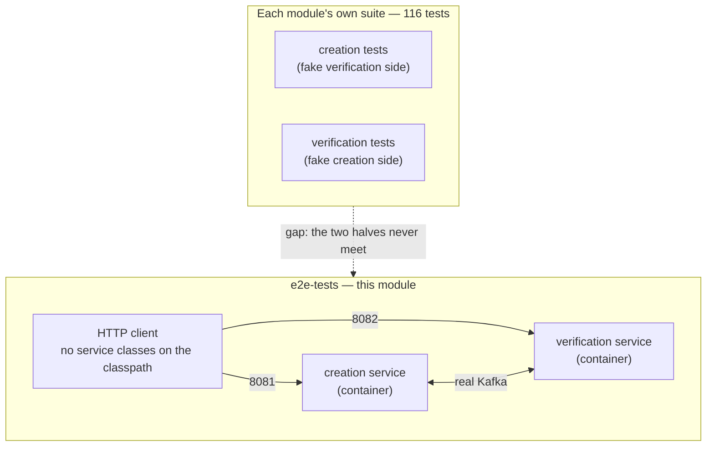

# End-to-end tests

Black-box tests that drive **both deployed services at once**, over real HTTP and real Kafka,
against real PostgreSQL.

## Why this module exists

Each service's own suite is thorough, but neither can cross the process boundary — each one plays
the *other* side itself with a test double. That leaves one thing unproven: that the two services
actually agree when they talk to each other for real. A code review of this project put it plainly:

> No single test drives both services together. Each module's test plays the other side, so the
> "no-reply, then SLA breach" path is proven in two halves.

This module closes that gap. It deliberately **does not depend on either service's classes** — if it
did, a test could pass against an in-JVM stand-in rather than the artifacts you actually ship.



## Running them

They need the compose stack up. From the repository root:

```bash
KYC_REVIEW_DELAY_MIN=PT5S KYC_REVIEW_DELAY_MAX=PT10S KYC_SLA_WINDOW=PT60S KYC_SLA_SWEEP_INTERVAL=PT5S \
  docker compose up -d --build
mvn -B -pl e2e-tests test
```

**With no stack running, every test skips rather than fails.** That is deliberate: `mvn -B test` and
the deterministic build gate have to stay green on a machine with no Docker daemon, so a missing
stack must never look like a broken build. The guard is `StackFixture.stackIsUp()`, which simply
asks both services for their health.

Point them elsewhere with `-De2e.creation.url=... -De2e.verification.url=...`.

## Timing-sensitive tests adapt

Some scenarios need a verdict, and on the default profile a verdict is 1–2 hours away. Rather than
read configuration it cannot see, the fixture **creates a real application and measures how far
away `verdictDueAt` is**. If it is more than two minutes out, the verdict and SLA-breach tests skip
and say so; otherwise they run. So the same suite behaves correctly against either profile.

## What is covered

| Test | Proves |
|---|---|
| **E2E-1** | Create returns `201 STARTED` in under a second, and the request reaches the *other* service's database |
| **E2E-2** | The acknowledgement travels back and advances the creation-side state |
| **E2E-3** | An identity mismatch fails the application with the offending role, and **both services agree** |
| **E2E-4** | A verdict completes the round trip; the two services' outcomes match; the reason is non-empty |
| **E2E-5** | A deliberately unanswered review is surfaced as an SLA breach, is findable via `?slaBreached=true`, and does **not** become a sixth state |
| **E2E-6** | Both services publish an OpenAPI 3 description and serve Swagger UI |
| **E2E-7** | A malformed PAN and a bad Aadhaar checksum are rejected — and the rejected value is never echoed back |
| **E2E-8** | The three people on one application must have distinct PANs |
| **E2E-9** | A second live application for the same PAN returns `409` carrying `existingApplicationId`, so a timed-out client can recover |
| **E2E-10** | Identity fields are immutable; address and income are not |
| **E2E-11** | An empty PATCH body is a no-op that still returns `200` |
| **E2E-12** | Soft delete hides the application and frees the PAN for a new one |
| **E2E-13** | Listing and filtering by KYC state |
| **E2E-14** | Unknown ids give `404`, never `500` |

E2E-4 and E2E-5 are the timing-sensitive pair. E2E-5 creates a batch of 40, because the no-reply
bucket is roughly 1 in 20 — and since the bucket is a deterministic hash of the application id
rather than a coin flip, a batch that size reliably contains one.
